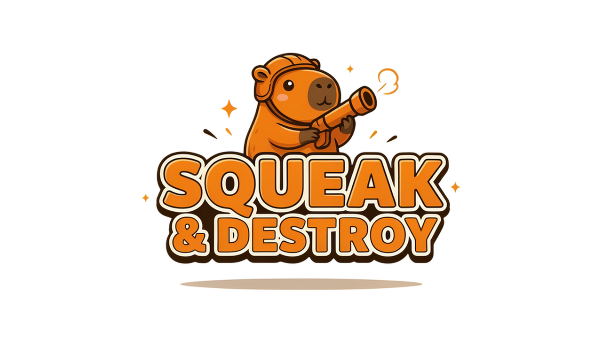
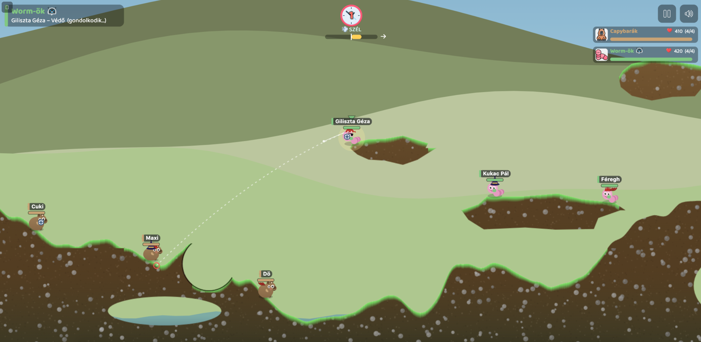

<p align="center">
  
</p>

<p align="center">
  <em>Cute. But deadly.</em><br>
  A turn-based artillery game with fully destructible terrain — in your browser, no install, no build step.
</p>

<p align="center">
  <a href="LICENSE"></a>
  <a href="LICENSE-ASSETS.md"></a>
  
</p>

<p align="center">
  
</p>

---

## What it is

Take turns, pick a weapon, judge the wind, and blow a hole in the map — and in
whoever is standing on it. Squeak & Destroy is a Worms-style artillery game that
grew a light RPG layer on top: every unit is an **animal species** (which decides
its passive and its ultimate) plus a **class** (which decides its role and skill
tree).

- **63 weapons** — rockets, cluster bombs, drills, airstrikes, jetpacks, teleports, mines, turrets
- **12 species** — capybara, worm, hedgehog, frog, owl, bird, koala, bat, beaver, fox, cat, penguin
- **6 classes** — guardian, hunter, mage, healer, engineer, necromancer, each with a skill tree
- **13 themes** — meadow, desert, snow, jungle, cave, islands, volcano, sky, beach, candy, space, graveyard, halloween
- **12 game modes** — classic, free-for-all, king of the hill, forts, survival, campaign, gauntlet, boss rush, nest, quick match, daily challenge, tutorial
- **Destructible terrain** — a real bitmap mask, not a tilemap; craters are permanent and units fall into them
- **Local multiplayer + AI** — hot-seat 2–4 teams, or three AI difficulties with distinct personalities
- **Runs offline** — PWA with a service worker; also wraps into Electron (desktop) and Capacitor (iOS)
- **6 languages** — English, Hungarian, German, Spanish, Portuguese, Simplified Chinese

Zero runtime dependencies. No framework, no bundler in the loop while you work —
plain ES5-compatible JavaScript on a `<canvas>`, with a DOM layer for the menus.

## Run it

Any static file server will do. There is nothing to install to *play*:

```bash
git clone https://github.com/lospolosadwords-dev/squeak-and-destroy.git
```

```bash
cd squeak-and-destroy && python3 -m http.server 8123
```

Then open <http://localhost:8123>. That is the whole setup.

For development, open `index.html?dev` — it loads the 50 individual modules
instead of the minified bundle, so you can edit a file and hit reload with no
build step.

### Building the production bundle

```bash
node build.js
```

This concatenates and minifies `js/*.js` into `bundle.min.js` via `esbuild`
(fetched with `npx`, no `node_modules` needed). Run it before deploying — the
production `index.html` loads the bundle, not the loose files.

## Controls

| | |
|---|---|
| **A / D** | move |
| **W / S** | aim |
| **Space** | jump |
| **Mouse** or **Enter** | hold to charge, release to fire |
| **1–9 / 0** | select weapon |
| **Q** | switch unit (before firing) |
| **Tab** | cycle weapon |
| **P / Esc** | pause |
| **Scroll**, **+ / −** | zoom |

Touch devices get an on-screen control pad and a landscape lock.

## How it is put together

Everything hangs off one global, `CA`, defined in `js/contract.js` — the single
source of truth for config, state, the event bus, and the **one** damage pipeline
(`CA.explode`). Modules never reach into each other's internals; they talk through
`CA.events` and the contract.

```
js/contract.js   config, state, event bus, CA.explode() — read this first
js/core.js       game loop, turn manager, camera, input, win conditions
js/terrain.js    destructible bitmap mask + cached painted canvas
js/entities.js   units: drawing, animation, physics, damage
js/weapons.js    63 weapons, ballistics, projectile stepping, AI aim prediction
js/ai.js         target selection, movement, weapon choice, self-frag avoidance
js/fx.js         parallax backgrounds, particles, WebAudio mixer
js/ui.js         canvas HUD, weapon bar, touch controls
js/menu*.js      DOM menu system (home, new game, settings, profile, ...)
js/modes.js      game modes as setup/turn/win hooks
```

More detail — including the rules that keep the game deterministic — is in
[docs/ARCHITECTURE.md](docs/ARCHITECTURE.md).

The `*.php` files are an **optional** backend for accounts, leaderboards, clans
and peer-to-peer signalling. The game is fully playable without them: single
player, local multiplayer and AI never touch the network.

## Licensing, in one paragraph

**Code is MIT.** Art and audio are not — original assets are CC BY-NC 4.0
([LICENSE-ASSETS.md](LICENSE-ASSETS.md)), third-party assets keep their own
licences ([ATTRIBUTIONS.md](ATTRIBUTIONS.md)), and the CC BY ones must stay
credited. Some art the closed-source builds shipped with is licensed for *use*
but not for *redistribution*, so it is not in this repository — the game falls
back to code-drawn graphics and runs fine.
[docs/ASSET_LICENSING.md](docs/ASSET_LICENSING.md) has the list, and replacing
that art with CC0 equivalents is the most useful thing a contributor could do
right now.

## Contributing

Yes please — see [CONTRIBUTING.md](CONTRIBUTING.md). Art, translations, balance
and bug fixes are all welcome.

## Credits

Built by **Los Polos Amigos Kft.** (Hungary) with Claude.
Third-party authors are credited in [ATTRIBUTIONS.md](ATTRIBUTIONS.md) and on the
in-game Credits screen.
